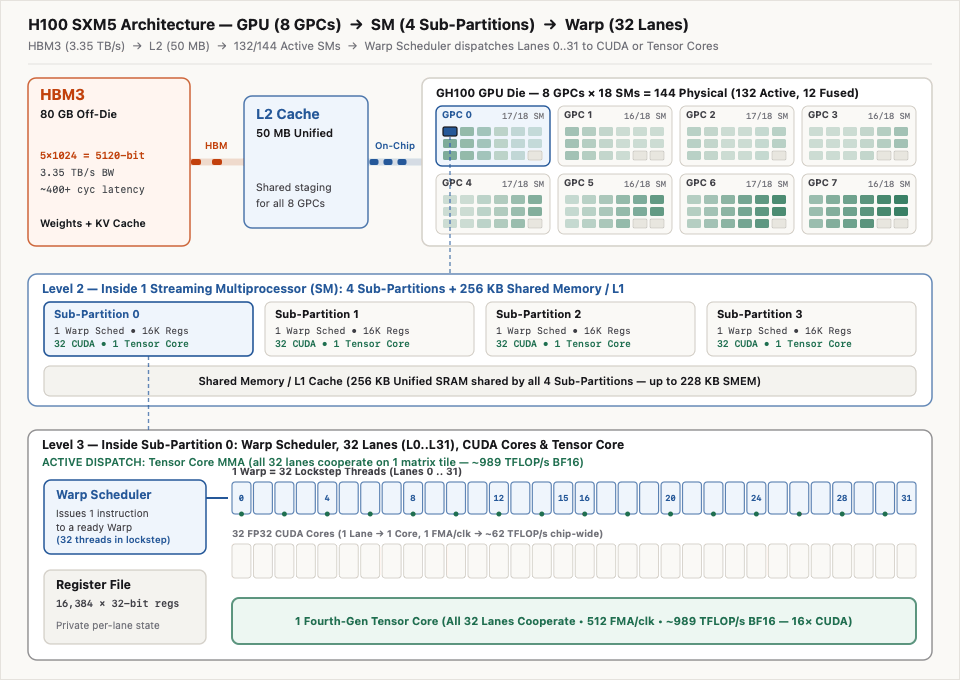
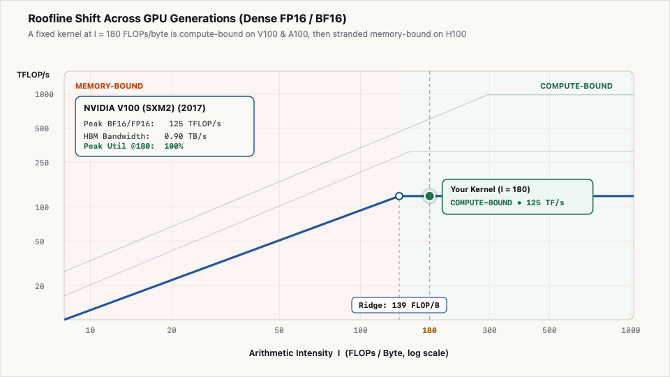

In [The Great AI Compromise](/ml/2026/08/26/the_great_ai_compromise.html), we saw a frustrating paradox: AI accelerators advertise enormous peak compute numbers, yet real workloads leave most of that capacity sitting idle. During LLM token generation, a single user step feels instant to a person while the GPU's math units spend almost all of their time waiting for data.

To understand why, and why kernel engineering is the practical way out, we need to open up the GPU and look at where data lives, how far it travels, and what sets the physical speed limit of any kernel.

---

## 1. Inside the GPU Ecosystem

A CPU is built around a small number of complex cores with deep pipelines, branch predictors, and control logic suited to sequential execution and unpredictable branching. A GPU makes the opposite trade-off: it packs thousands of simpler execution units onto the die to run the same math across large blocks of data in parallel.

Reading the diagram from top to bottom gives you the exact physical nesting of an **NVIDIA H100 (GH100)**: **HBM3 → L2 Cache → 8 GPCs → 132 active SMs → 4 sub-partitions per SM → 32-lane warps**. Three layers matter immediately when you write or profile a kernel:

- **High Bandwidth Memory (HBM):** High-capacity off-die memory sitting beside the compute die over an ultra-wide bus. On an H100 SXM5, **5 active HBM3 stacks (5 × 1,024-bit = 5,120-bit aggregate bus)** deliver **3.35 TB/s**. Static model weights (2 bytes per parameter in BF16) and dynamic KV caches live here. Even with massive aggregate bandwidth, every HBM fetch pays hundreds of clock cycles of latency.
- **L2 Cache:** A shared **50 MB** on-chip cache sitting between HBM and all Streaming Multiprocessors (SMs), acting as a common staging layer across the chip.
- **SMs, Blocks, and Warps:** GPU work launches as a grid of **thread blocks**, which the hardware schedules onto **SMs** in **waves** based on per-SM limits for threads, warps, registers, and shared memory. Inside each SM, threads execute in lockstep groups of **32** called **warps** (SIMT), backed by private per-thread **registers** (64K 32-bit registers per SM) and **256 KB of unified on-chip SRAM** per SM (configurable as up to 228 KB of shared memory, with the rest serving as L1 cache).

### Not Every SM Is Active, and Not Every Core Is Equal

A full GH100 die contains **8 GPCs** (Graphics Processing Clusters) with **18 SMs** each, for **144 physical SMs** total. On a shipping H100 SXM5, **132 SMs are active** (roughly **92%** of the full die). Microscopic manufacturing defects and power/thermal binning mean NVIDIA fuses off a handful of SMs rather than discarding an entire giant die.

Inside each of those **132 active SMs**, execution is split across **4 sub-partitions (4 warp schedulers)**. Peak compute depends heavily on *which* math units your kernel targets. Counting each fused multiply-add (FMA) as **2 FLOPs** at a **1.83 GHz** clock:

- **CUDA Cores (FP32 scalar/SIMT):** **128 FP32 cores per SM** (32 per sub-partition), 1 FMA per tick:

  $$132 \times 128 \times 2 \times 1.83 \times 10^9 \approx 61.8\text{ TFLOP/s}$$

- **Tensor Cores (Dense BF16 / FP16):** **4 fourth-generation Tensor Cores per SM** (1 per sub-partition), **512 multiply-adds per tick**:

  $$132 \times 4 \times 512 \times 2 \times 1.83 \times 10^9 \approx 989.4\text{ TFLOP/s}$$

That is a **16× gap** between dense BF16 Tensor Core throughput and FP32 CUDA core throughput on the same chip. Both units are driven at the **warp level**: on CUDA cores, a warp's 32 lanes map 1-to-1 across the 32 cores for independent scalar math. On a Tensor Core, all 32 lanes cooperate on a single matrix tile (and on Hopper, 4 warps—128 threads—can cooperate asynchronously across an SM via `wgmma`).

| Execution Unit | Typical Operations | Usual Bottleneck |
| :--- | :--- | :--- |
| **Tensor Cores** | Dense matrix multiplications (GEMMs), QKV & MLP projections, batched matmuls | Compute ceiling (once arithmetic intensity crosses the ridge) or tile/pipeline stalls |
| **CUDA Cores & Special Function Units (SFUs)** | Element-wise activations (SiLU, GELU), norms (RMSNorm/LayerNorm), softmax, residual adds, indexing | Often **HBM bandwidth** or launch/control overhead rather than scalar FLOPs |

---

## 2. Arithmetic Intensity: The Kernel Engineer's Compass

To tell whether a kernel is letting the GPU compute or forcing it to wait, measure its **Arithmetic Intensity ($I$)**, defined as the ratio of math performed to bytes moved (typically across HBM):

$$I = \frac{\text{Total FLOPs}}{\text{Total Bytes Transferred}}$$

- **Low arithmetic intensity** means moving a lot of bytes for very little math. Serving a single user on an 8B parameter model in BF16 streams roughly 16 GB of weights (plus KV cache) to perform ~16 billion FLOPs per generated token: right around **1 FLOP/byte**. A naive matmul that re-fetches both BF16 inputs from HBM on every FMA without reuse drops to **0.5 FLOPs/byte** (2 FLOPs per FMA divided by 4 bytes for two BF16 operands).
- **High arithmetic intensity** means reusing every loaded byte across many multiply-adds, such as a well-tiled GEMM or a larger batch where weights are amortized across many tokens.

Because a **kernel** is an atomic unit of GPU execution, splitting a forward pass into many tiny, un-fused kernels that write intermediate tensors out to HBM and read them right back inflates the denominator while adding almost nothing to the numerator.

---

## 3. The max() Time Bound and the Roofline Plot

A clean first-order estimate for how long a kernel takes is:

$$T_{\text{kernel}} \approx \max\left(\frac{\text{Bytes Transferred}}{\text{Memory Bandwidth}}, \frac{\text{Computed FLOPs}}{\text{Peak FLOPs}}\right)$$

The $\max$ is there because a kernel cannot finish faster than the slower of moving its required bytes or running its required FLOPs. *(Real kernels also pay launch overhead, non-matmul work, wave quantization, and sub-peak utilization, so treat this as a physical lower bound rather than an exact stopwatch.)*

Plug our 8B single-user token step on an H100 into that formula:

- **Memory transfer time:** $16\text{ GB} / 3.35\text{ TB/s} \approx 4.78\text{ ms}$
- **Tensor Core math time:** $16\text{ GFLOPs} / 989\text{ TFLOP/s} \approx 0.016\text{ ms}$
- **Result:** $\max(4.78\text{ ms}, 0.016\text{ ms}) = 4.78\text{ ms}$. The Tensor Cores are active for **0.3%** of the step and waiting for **99.7%**.

Plotting that bound across all arithmetic intensities gives the **Roofline plot**:

- **X-axis:** Arithmetic intensity ($\text{FLOPs/byte}$).
- **Y-axis:** Attainable compute throughput ($\text{TFLOP/s}$).
- **Sloped memory roof:** At low intensity, throughput is capped by $\text{Bandwidth} \times I$. The kernel is **memory-bound**.
- **Flat compute plateau:** Once intensity is high enough, throughput hits the hardware compute ceiling (~989 TFLOP/s on H100). The kernel is **compute-bound**.

The **ridge point** is where the two roofs meet:

$$\text{Ridge Point} = \frac{\text{Peak FLOP/s}}{\text{Peak Memory Bandwidth}}$$

For an H100 SXM5 at **~989 TFLOP/s** (dense BF16) and **3.35 TB/s** (HBM3), the ridge sits at **~295 FLOPs/byte**. Below 295 FLOPs/byte, memory bandwidth sets the pace; above it, compute sets the pace.

---

## 4. Why Newer GPUs Push Old Kernels Into the Memory-Bound Zone

Here is the catch that surprises teams expecting a hardware upgrade to automatically keep every kernel fast: across GPU generations, **peak compute (especially Tensor Core FLOPs) scales much faster than memory bandwidth**.

| GPU (SXM) | Dense FP16/BF16 Peak | HBM Bandwidth | Ridge Point (FLOPs/byte) |
| :--- | :---: | :---: | :---: |
| **V100** | 125 TFLOP/s | 0.90 TB/s | **~139** |
| **A100** | 312 TFLOP/s | 2.04 TB/s | **~153** |
| **H100** | 989 TFLOP/s | 3.35 TB/s | **~295** |

Watch what happens to a kernel with a fixed arithmetic intensity of **180 FLOPs/byte**:

- On a **V100** (ridge ~139) and an **A100** (ridge ~153), 180 FLOPs/byte sits **to the right of the ridge**. The kernel is compute-bound and saturates the Tensor Cores.
- Move that *exact same kernel* to an **H100** (ridge ~295), and the ridge sweeps past it. At 180 FLOPs/byte, it is now **stranded to the left of the ridge (memory-bound)** because the newer Tensor Cores consume data faster than HBM3 can feed them.

Worse, the hardware limits are frozen once the chip ships. On-chip SRAM barely scales at modern process nodes and sits against die-area limits, and while HBM *capacity* can grow by stacking more DRAM dies, an H100's **256 KB/SM of SRAM** and **3.35 TB/s of HBM-to-SM bandwidth** are fixed in silicon.

You cannot widen the HBM bus or add more shared memory in software. The only way to stop Tensor Cores from waiting is to **squeeze as many floating-point operations as possible out of every byte you fetch**: tiling data into registers and shared memory for reuse, fusing operations so intermediates never round-trip to HBM, and overlapping whatever memory latency remains. That is where GPU kernel engineering stops being an optional polish and becomes the only real lever left.

---

## Questions Before the Next Installment

We will stop here before opening the optimization playbook. Keep these three questions in mind for the next post:

1. **Batching vs. KV cache:** Batching more users raises arithmetic intensity and pushes you right along the Roofline. Why doesn't higher concurrency simply give every user low latency, and where does KV-cache traffic start pushing back?
2. **Un-fused glue around matmuls:** When most raw FLOPs live inside Tensor Core matmuls, how much wall-clock time gets lost to tiny CUDA-core steps and extra HBM reads and writes in between?
3. **On-chip layout traps:** Once data reaches shared memory or registers, how do global memory coalescing, shared-memory bank conflicts, and register/SMEM budgets dictate whether a kernel actually runs fast?

---

## Acknowledgments & References

- **Learning acknowledgment:** Much of my hands-on foundation for this series comes from the [Vizuara AI Kernel Engineering Workshop](https://kernelworkshop.vizuara.ai/) by [Vizuara.ai](https://vizuara.ai/).
- **NVIDIA H100 Tensor Core GPU Datasheet & Hopper Tuning Guide:** Official H100 SXM5 specifications (132 active SMs, 5,120-bit HBM3 at 3.35 TB/s, 50 MB L2, 256 KB SRAM/SM, 4th-gen Tensor Cores) — [H100 Datasheet](https://resources.nvidia.com/en-us-tensor-core/nvidia-tensor-core-gpu-datasheet) and [Hopper Tuning Guide](https://docs.nvidia.com/cuda/hopper-tuning-guide/).
- **NVIDIA Deep Learning Performance Guide:** [GPU Performance Background](https://docs.nvidia.com/deeplearning/performance/dl-performance-gpu-background/index.html) (arithmetic intensity, memory-bound vs. math-bound regimes, and Tensor Core utilization).
- **NVIDIA CUDA Programming Guide:** [CUDA Programming Guide](https://docs.nvidia.com/cuda/cuda-programming-guide/) (SIMT execution, warps, thread blocks, registers, and shared memory).
- **Roofline Model (Original Paper):** Samuel Williams, Andrew Waterman, and David Patterson, *"Roofline: An Insightful Visual Performance Model for Multicore Architectures,"* *Communications of the ACM*, 52(4), 65–76 (2009), DOI `10.1145/1498765.1498785`.
